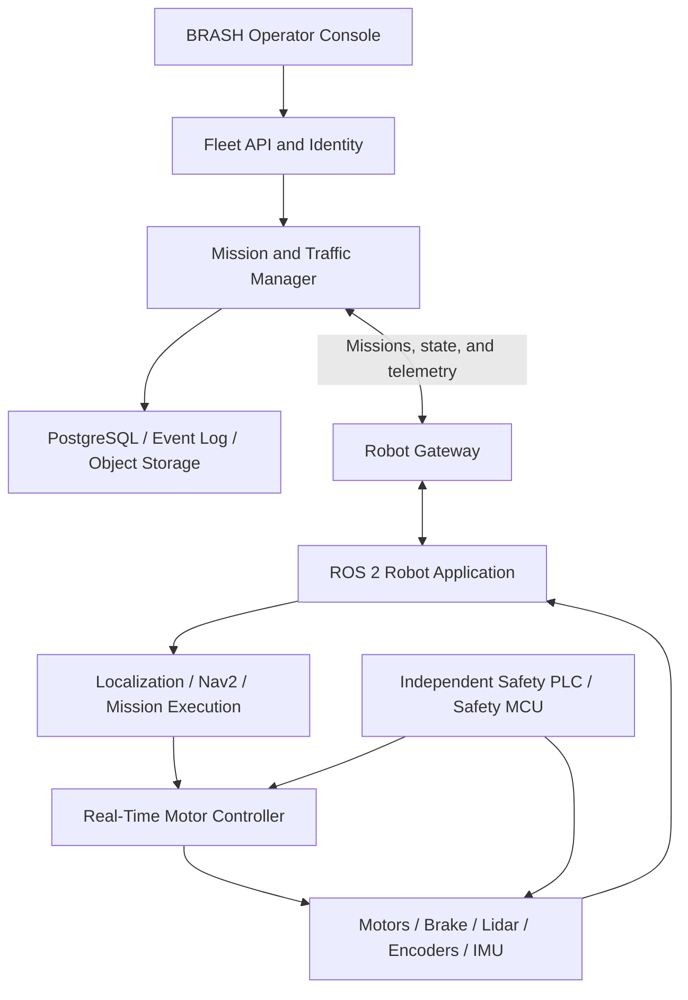

# BRASH Fleet Control

An indoor mobile robot fleet, map, and mission management system for BRASH Robotics.

> [!WARNING]
> This repository currently contains a working **product draft**. The robots are simulated. The “Controlled stop” button in the UI is not a safety function and must never replace a physical emergency stop.

## Current status

What works today:

- Layered factory map
- Six simulated robots with near-real-time telemetry
- Robot selection, filtering, and detail view
- Mission creation and mission flow
- Alerts and live event list
- Stop and resume demonstration
- Local Node.js server with HTTP/SSE data contracts
- Automated tests for the server API
- Optional PostgreSQL persistence for Fleet Core
- Atomic multi-process robot/mission reservation
- Durable command outbox with restart recovery
- Versioned factory traffic graph with deterministic shortest-path routing
- PostgreSQL-backed edge/node time-window reservations
- Conservative full-route scheduling that prevents reservation deadlocks
- Live topology, route, delay, and reservation visibility in the operator console
- Heartbeat-based `ONLINE`, `DEGRADED`, and `OFFLINE` robot liveness
- Renewable route leases and conservative traffic safety holds
- Safe mission recovery or reassignment after explicit robot-state confirmation
- Operator-initiated mission cancellation with robot confirmation and safe traffic release

What is not production-ready yet:

- Motor, safety PLC, and sensor integrations
- Real localization and navigation
- Priority preemption, automatic cancellation retry, and dynamic obstacle replanning
- Authentication and role-based authorization
- Device certificates, signed OTA updates, and rollback
- Production observability and black-box recording
- Conformity assessment and on-site safety validation

## Run locally

Use Node.js 22 or newer:

```powershell
node server.mjs
```

Then open `http://127.0.0.1:4173`.

### Run the new Fleet Core vertical slice

The repository now also contains the first vendor-independent Fleet Core implementation:

- Canonical robot and mission contracts
- Mission and robot domain state machines
- Robot Adapter SDK
- Deterministic SimulatorAdapter
- Capability, payload, map, zone, availability, and battery filtering
- Explainable weighted robot selection
- Map-aware routing and conflict-free traffic time slots
- Idempotent command handling
- Mission execution state reconciliation
- Queued and in-flight mission cancellation with explicit adapter confirmation
- Offline-robot recovery without duplicate physical mission execution
- Versioned `/api/v1` HTTP endpoints

Start it separately from the existing operator demo:

```bash
npm run dev:core
```

The Fleet Management screen is available at `http://127.0.0.1:4273`; the Fleet
Core API is served under `http://127.0.0.1:4273/api/v1`. See the [Fleet Core quick start](./docs/api/FLEET_CORE_QUICKSTART.md) for a complete mission example.

Run the tests:

```powershell
node --test tests/fleet-server.test.mjs
node --check public/app.js
```

Run the new Fleet Core validation:

```bash
npm run typecheck
npm run test:core
```

## Target system architecture



Core boundaries:

1. The cloud or fleet service never runs the motor velocity loop; it only assigns missions.
2. A robot must remain safe or reach a safe state when the internet or factory network is unavailable.
3. The safety PLC/MCU is independent of the main computer and web UI.
4. A normal controlled stop and a physical emergency stop are separate functions.
5. An AI or perception model must not be the sole implementation of a safety function.
6. Every mission, command, configuration, and map must be versioned and traceable.

## Roadmap from demo to production

Time estimates depend on team size, hardware lead times, certification scope, and access to the factory. Close each phase and meet its acceptance criteria before promoting the next phase to production.

### Phase 0 — Use case and safety scope

**Goal:** Define exactly where the robot operates, what it carries, and who shares its operating area.

Tasks:

- Define robot type, drive geometry, maximum speed, payload, and center of gravity.
- Document the Operational Design Domain (ODD): floor, slope, aisle width, lighting, temperature, dust, pedestrians, and forklift traffic.
- Identify normal operation, maintenance, manual driving, charging, and reasonably foreseeable misuse.
- Collect factory CAD drawings, doors, elevators, machines, stations, crossings, and restricted areas.
- Create a hazard log covering collision, crushing, tipping, dropped load, brake failure, localization loss, connectivity loss, battery, and fire scenarios.
- Define risk-reduction measures and safety functions with a qualified machinery safety specialist.
- Determine applicable regulations and the conformity assessment path for each target market.

Deliverables:

- System Requirements Specification
- ODD document
- Factory traffic and pedestrian analysis
- Hazard log and initial risk assessment
- Safety Concept and responsibility matrix
- Traceable requirement IDs such as `SYS-*`, `SAFE-*`, and `SEC-*`

**Exit criterion:** The product owner, robotics team, factory EHS team, and machinery safety specialist approve the scope in writing.

### Phase 1 — Hardware and independent safety chain

**Goal:** Build a physical robot platform that prevents hazardous motion even if the application software crashes.

Tasks:

- Select motors, brakes, encoders, power distribution, and battery management.
- Add safety-rated lidar/scanners, bumpers, emergency stops, and safe speed monitoring where required.
- Use a safety PLC or safety MCU to control motor enable and braking independently of the main computer.
- Define safe states for watchdog timeout, communication loss, sensor failure, and power loss.
- Measure stopping distances for every relevant payload, speed, turn, floor, and slope combination.
- Validate protective fields and sensor placement against the risk assessment.
- Separate maintenance/manual mode with a physical key and restricted speed where required.

Important distinction:

```text
Web button → Normal controlled-stop request
Safety PLC / physical E-stop → Independent safety stop
```

**Exit criterion:** Required Performance Levels for safety functions are defined, calculated, and validated on site. The physical safety chain remains effective while the web UI and ROS 2 computer are offline.

### Phase 2 — Core onboard software

**Goal:** Establish a traceable edge platform that brings up one robot reliably.

Recommended starting point:

- Ubuntu 24.04 LTS
- ROS 2 Jazzy LTS, with exact package versions pinned for the project
- C++ for drivers, controls, and timing-sensitive components
- Python for orchestration, tooling, and rapid prototypes
- C/C++ with an RTOS on microcontrollers
- An appropriate field bus such as CAN/CAN-FD or EtherCAT

ROS 2 packages to develop:

```text
brash_robot/
├── brash_description       # URDF, geometry, and sensor frames
├── brash_base_driver       # Motor and encoder driver
├── brash_sensor_drivers    # Lidar, IMU, camera, and bumper drivers
├── brash_safety_bridge     # Reports safety state; never makes safety decisions
├── brash_localization
├── brash_navigation
├── brash_mission_executor
├── brash_diagnostics
└── brash_robot_gateway
```

Rules:

- The TF tree follows at least `map → odom → base_link → sensor_frames`.
- Services use ROS 2 Lifecycle states: `unconfigured`, `inactive`, `active`, and `finalized`.
- Configure time synchronization, device identity, log rotation, and disk-full protection.
- The robot must complete a power-on self-test before entering a motion-enabled state.
- Version critical configurations and record which version runs on each robot.

**Exit criterion:** On a test stand and in a low-speed enclosed test area, the robot repeatedly executes manual velocity commands, watchdog behavior, encoder/IMU reporting, and controlled stops.

### Phase 3 — Mapping, localization, and single-robot navigation

**Goal:** Make one robot navigate reliably between defined destinations in a controlled factory area.

Tasks:

- Convert the CAD plan into a shared factory coordinate system.
- Keep three map representations separate:
  - occupancy map for localization and obstacles
  - semantic map for stations, charging, speed limits, restricted zones, and one-way areas
  - traffic graph for fleet routes and intersections
- Calibrate lidar, IMU, and encoders.
- Generate the first map with SLAM; prefer localization against a controlled static map in production.
- Configure Nav2 global planning, local control, costmaps, recovery behavior, and docking.
- Define explicit behavior for low localization confidence or complete localization loss.
- Test pedestrian, forklift, pallet, and temporary-obstacle scenarios.

Metrics to measure:

- Position and heading error
- Path-tracking error
- Docking repeatability
- Mission completion time
- Replanning time
- Localization-loss rate
- Measured stopping distance for every speed and payload state

Initial engineering targets could be 5 cm position error and 2° heading error, but final acceptance limits must be derived from the robot, station geometry, and risk assessment.

**Exit criterion:** A single robot operates between defined stations for a full shift in the enclosed pilot area without manual intervention, with all failure scenarios recorded.

### Phase 4 — Robot Gateway and production data contract

**Goal:** Replace the simulator behind the existing web UI with a real robot while keeping a stable interface.

Migration points:

| Demo | Production system |
|---|---|
| Simulator in `server.mjs` | ROS 2 ↔ Fleet Gateway |
| In-memory robot list | Robot state service + PostgreSQL |
| `/api/fleet/snapshot` | Persistent Fleet API |
| `/api/fleet/stream` | SSE/WebSocket telemetry channel |
| Demo `stop` request | Normal controlled-stop request |
| Static factory map | Versioned semantic map service |

Initial robot-state contract:

```json
{
  "schemaVersion": "1.0",
  "robotId": "BR-01",
  "sequence": 10482,
  "observedAt": "2026-08-11T20:30:00.123Z",
  "pose": {
    "mapId": "plant-a-floor-01@7",
    "x": 12.42,
    "y": 8.17,
    "yaw": 1.57,
    "localized": true,
    "localizationScore": 0.94
  },
  "motion": { "speed": 0.72, "mode": "AUTO" },
  "power": { "stateOfCharge": 0.68, "charging": false },
  "safety": { "protectiveStop": false, "emergencyStop": false },
  "activeMissionId": "M-1042"
}
```

Command rules:

- Every command includes a unique `commandId`, `issuedAt`, `expiresAt`, and `schemaVersion`.
- Repeating the same `commandId` returns the same result and never executes the command twice.
- The robot acknowledges commands as `accepted`, `rejected`, `running`, `completed`, or `failed`.
- Expired commands and commands targeting an incompatible map version are rejected.
- During a connection outage, messages are buffered locally with bounded storage and preserved ordering.
- Safety state is transmitted with higher priority than ordinary telemetry, but network messages never replace the safety chain.

If multiple robot vendors must be supported, plan a [VDA 5050 3.0.0](https://github.com/VDA5050/VDA5050/releases/tag/3.0.0) adapter at the fleet boundary. Keep an adapter layer instead of exposing internal ROS 2 messages as the public API.

**Exit criterion:** The UI displays a real robot, submits a mission, tracks acknowledgements, and does not create duplicate missions after a network disconnect and reconnect.

### Phase 5 — Persistent fleet backend and multi-robot traffic

**Goal:** Manage multiple robots in a shared coordinate system with explicit traffic rules.

Services to add:

- Robot Registry and device identity
- Mission Service and mission state machine
- Map/Zone Service and map versions
- Traffic Manager with lane/intersection reservations
- Charging Scheduler
- Alarm/Event Service
- Users, roles, and audit log
- PostgreSQL and object storage

Traffic responsibility boundary:

```text
Fleet: global route, aisle/intersection reservations, fleet priorities
Robot: local planning, unexpected obstacle avoidance, controlled stop
Safety: safely remove or limit motion energy when a hazard is detected
```

Evaluate [Open-RMF](https://github.com/open-rmf/rmf) when orchestration includes doors, elevators, and heterogeneous fleets. A VDA 5050 adapter may be sufficient for a simpler project that only needs robot-to-fleet communication. Do not add both without a concrete requirement.

Required traffic tests:

- Two robots in a narrow aisle
- Four-way intersection
- Deadlock and livelock
- Robot disconnect during a reservation
- Failed robot blocking a route
- Charging queue and low-battery behavior
- Reintroducing a manually moved robot into the fleet

**Exit criterion:** At least three robots complete a long-running pilot without conflicting reservations, deadlocks, or lost missions.

### Phase 6 — Cybersecurity, identity, and OTA updates

**Goal:** Build a production system in which every robot can be authenticated and every update is secure and reversible.

Tasks:

- Assign a unique device identity and certificate to every robot.
- Use mTLS between robots, gateways, and cloud services.
- Apply least-privilege broker and API permissions per robot and service.
- Segment safety/OT, robot, management, and guest networks.
- Never place permanent API keys in source code or device images.
- Sign software and firmware packages.
- Implement atomic A/B updates or an equivalent rollback mechanism.
- Roll out OTA updates to a test robot, then a small canary group, then the fleet.
- Maintain an SBOM, vulnerability scanning, incident response, and end-of-support policy.
- Test certificate renewal, revocation, and lost-device procedures.

**Exit criterion:** An unauthorized device cannot publish commands; a failed update returns the robot to its previous working version; every administrative operation appears in the audit log.

### Phase 7 — Observability and black-box recording

**Goal:** Reconstruct every field failure as a timeline.

Collect:

- Structured logs with `robotId`, `missionId`, `commandId`, version, and timestamp
- Metrics for CPU, temperature, disk, network, battery, localization, missions, and latency
- Distributed traces across fleet and gateway services
- Bounded rosbag/sensor recordings before and after important events
- Map, configuration, container, and firmware versions
- Operator action audit logs

Define retention periods, camera/privacy rules, and upload bandwidth before collecting production data. Do not continuously upload all camera and raw lidar data to the cloud.

**Exit criterion:** The team can determine the root cause of a selected failure scenario using only centralized records and black-box data.

### Phase 8 — Simulation, HIL, and verification

**Goal:** Automate normal and failure behavior tests before entering the factory.

Test pyramid:

```text
Unit tests
  → Component and contract tests
    → Recorded-data replay
      → Gazebo simulation
        → Software-in-the-loop
          → Hardware-in-the-loop
            → Enclosed physical test
              → Controlled factory pilot
```

Fault injection scenarios:

- Lidar, encoder, or IMU data loss
- Invalid or skipped timestamps
- Localization jump or loss
- Network latency, packet loss, and complete outage
- Service crash and restart
- Low battery and charger failure
- Map version mismatch
- Stuck mission and duplicated command
- Protective stop and physical E-stop
- Full disk and corrupt update

Every safety requirement must link to evidence from a test, analysis, or inspection. Store each result with its software version, hardware revision, and configuration.

**Exit criterion:** Every critical requirement has traceable verification evidence and no critical or major defects remain open.

### Phase 9 — Controlled factory pilot

**Goal:** Introduce the system into real operations with controlled risk.

Recommended progression:

1. One robot with no payload in a physically separated area.
2. One robot with a real payload under supervision.
3. One shift and a limited station set.
4. Two or three robots with controlled pedestrian traffic.
5. Door, charging, and production-system integrations.
6. Multiple shifts and gradual fleet expansion.

Pilot KPIs:

- Successful mission completion rate
- Mean time between interventions
- Mission cycle time and queue wait time
- Localization loss and replanning count
- Protective-stop and emergency-stop events
- Charger availability
- Network and service availability
- Type and cause of human intervention

Prepare a rollback plan before each expansion. A critical safety event, unexpected movement, or unrepeatable loss of control automatically stops the pilot.

**Exit criterion:** Pilot KPI targets are met, the risk assessment reflects field findings, and operations/maintenance teams are trained.

### Phase 10 — Production and lifecycle operations

**Goal:** Operate the fleet safely and sustainably throughout its lifecycle.

- Release channels: development, test, pilot, and production
- Maintenance schedule and spare-parts management
- 24/7 alerting and escalation procedure
- Certificate and key rotation
- Backup and restore exercises
- Periodic brake, sensor, and safety-function tests
- Post-incident review and corrective action
- End-of-support and safe decommissioning process
- Updated risk assessment after every map or factory-layout change

## Practical first 90 days

### Days 1–30

- Write robot and operational requirements.
- Define the ODD, hazard log, and safety responsibilities.
- Select the single-robot hardware architecture and safety chain.
- Prepare the factory CAD plan and station list.
- Create the ROS 2 workspace, URDF, and driver skeletons.
- Freeze the `RobotStateV1` and `MissionCommandV1` schemas.

### Days 31–60

- Bring up motor, encoder, IMU, and lidar drivers.
- Validate TF, odometry, diagnostics, and rosbag recording.
- Complete low-speed manual-motion tests in an enclosed area.
- Produce the first map and measure localization performance.
- Connect the Robot Gateway so this UI receives real telemetry.

### Days 61–90

- Run single-robot station-to-station missions with Nav2.
- Add network-loss, service-crash, and localization-loss tests.
- Introduce PostgreSQL-backed mission and event persistence.
- Add device certificates and the first signed OTA workflow.
- Prepare the acceptance test plan for a physically separated pilot area.

## Proposed repository structure

```text
brash-robotics/
├── firmware/
│   ├── motor-controller/
│   └── safety-bridge/
├── robot_ws/
│   └── src/
│       ├── brash_description/
│       ├── brash_drivers/
│       ├── brash_navigation/
│       ├── brash_mission_executor/
│       └── brash_robot_gateway/
├── interfaces/
│   ├── json-schema/
│   ├── protobuf/
│   └── vda5050/
├── fleet/
│   ├── api/
│   ├── missions/
│   ├── traffic/
│   ├── maps/
│   └── telemetry/
├── operator-ui/
├── simulation/
├── hil/
├── deployment/
├── tests/
└── docs/
    ├── architecture/
    ├── safety/
    ├── security/
    ├── verification/
    └── adr/
```

Do not create every directory at once. Add only the components owned by the phase currently being implemented.

## Questions to answer before production

- Is the robot an AMR or AGV? Is the drive differential, omnidirectional, or another geometry?
- What are the maximum total mass, payload, speed, and slope?
- Will it share the area with pedestrians and forklifts?
- Which lidar, IMU, encoders, cameras, and motor drives will be used?
- Which safety PLC/scanner vendor and safety functions are planned?
- Are the first factory plan and station coordinates available?
- How many robots, shifts, and missions per hour are expected?
- Are SAP/MES/WMS, automatic doors, elevators, or conveyors in scope?
- Is this a single-vendor or heterogeneous fleet?
- In which countries will the product be marketed or operated?
- Who is the machinery manufacturer, system integrator, and operator?

## Safety and regulatory references

This list is not a certification decision or legal advice. A qualified machinery safety specialist must determine which standards apply to the robot type, use case, and target country.

- [ISO 3691-4:2023 — Driverless industrial trucks and their systems](https://www.iso.org/standard/83545.html)
- [ISO 12100:2010 — Risk assessment and risk reduction](https://www.iso.org/standard/51528.html)
- [ISO 13849-1:2023 — Safety-related parts of control systems](https://www.iso.org/standard/73481.html)
- [ISO 13850:2015 — Emergency stop function](https://www.iso.org/standard/59970.html)
- [ISO 13855:2024 — Positioning of safeguards](https://www.iso.org/standard/80590.html)
- [IEC 62443-3-3 — IACS system security requirements](https://webstore.iec.ch/en/publication/7033)
- [IEC 62443-4-1 — Secure product development lifecycle](https://webstore.iec.ch/en/publication/33615)
- [Regulation (EU) 2023/1230 on machinery — consolidated text](https://eur-lex.europa.eu/eli/reg/2023/1230/en)
- [ROS 2 documentation](https://docs.ros.org/)
- [Nav2 documentation](https://docs.nav2.org/)
- [VDA 5050 official specification](https://github.com/VDA5050/VDA5050)
- [Open-RMF](https://github.com/open-rmf/rmf)

The EU Machinery Regulation (EU) 2023/1230 generally applies from **January 20, 2027**. Technical documentation, risk assessment, conformity assessment, and operating instructions are development deliverables—not paperwork to create after the product is finished.

## Never do this

- Treat a web or cloud connection as a safety function
- Send direct motor velocity commands over the internet
- Configure safety-scanner fields only through trial and error
- Embed permanent passwords or API keys in a robot image
- Assign missions when robot and fleet map versions are incompatible
- Ship unsigned OTA updates or updates without rollback
- Treat simulation success as field safety validation
- Handle critical sensor failures only as UI alerts
- Make untraceable manual configuration changes on production robots
- Expand a pilot while critical defects remain open
