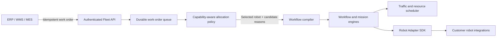

# Work-Order Orchestrator Architecture

## Intent

The orchestrator is the stable boundary between a factory business system and heterogeneous robot fleets. A caller describes the outcome—move a load and optionally visit service resources—without selecting a vendor protocol or issuing robot commands.

## Decision inputs

Allocation first rejects robots that are offline, unavailable, on another map revision, under payload capacity, missing a requested capability, below the minimum battery threshold, or outside their allowed zones. Eligible candidates are sorted by a deterministic weighted score. Every rejection and score component is returned to operators and retained with the order.

Allocation does not reserve a physical robot indefinitely. The workflow mission carries the chosen robot as a preference; the transactional mission dispatcher revalidates current state and may substitute another eligible robot if conditions changed. The work order records the actual substitute, and later mission steps inherit that latest selection. This keeps the decision safe under stale business-system assumptions while preserving an explainable initial choice.

## Durable execution

`PENDING` orders are leased by a background worker. An unavailable fleet causes bounded exponential retry rather than data loss. Once allocated, the compiler creates a durable DAG workflow:

1. A transport mission moves from pickup to dropoff.
2. Optional actions run sequentially as wait, charge, inspection, or dock steps.
3. Service steps validate typed `SERVICE_EXCLUSIVE` resources and reserve them through the workflow engine.
4. Work-order state follows workflow state through success, failure, or controlled cancellation.

PostgreSQL uniqueness on `external_reference` makes ERP/WMS retries idempotent. `FOR UPDATE SKIP LOCKED` claiming and expiring leases allow multiple server instances without duplicate allocation processing.

## Safety and integration boundary

The orchestrator never issues velocity or motor commands and is not a safety system. The existing Fleet Core, adapter, onboard controller, and independent robot safety chain remain authoritative. Customer-specific systems should be integrated through authenticated API clients and Robot Adapter SDK implementations, not by changing the allocation core.
